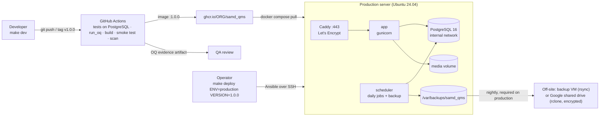

# SAMD_QMS deployment guide

SAMD_QMS ships as one container image that runs the same way in development and production.
Everything needed to build, run, provision, deploy and back it up is code in this repository.

| Environment | How it runs | Defined in |
| --- | --- | --- |
| Development (your laptop) | Docker Compose: app with live reload, PostgreSQL 16, Mailpit mail catcher | `compose.yaml`, `deploy/env/dev.env` |
| Staging and production (one Linux server each) | Docker Compose: Caddy (automatic HTTPS), app (gunicorn), scheduler, PostgreSQL 16 | `deploy/compose.prod.yaml`, `deploy/Caddyfile` |
| Server set-up and releases | Ansible over SSH | `deploy/ansible/` |
| Build, test, OQ evidence, image | GitHub Actions → GitHub Container Registry | `.github/workflows/ci.yml` |



## Development

Requirements: Docker with the Compose plugin, and `make`.

```bash
make dev            # build and start; app at http://localhost:8000, emails at http://localhost:8025
make demo           # load the two demo devices and users (password demo-pass-123)
make test           # run the test suite against the dev PostgreSQL (browser tests skipped: no browser in the image)
make oq NAME="You"  # OQ evidence on your machine against the dev PostgreSQL, browser tests included
make shell          # Django shell
make manage CMD="createsuperuser"
make jobs           # also run the scheduler
make dev-reset      # wipe the dev database, files and backups
```

The source folder is mounted into the container, so code changes reload immediately. The
container migrates the database on start (`QMS_MIGRATE_ON_START=1`). Every email the app sends
appears in Mailpit. To try single sign-on locally, register a test app with the provider (ORCID
has a sandbox), add its `SSO_*` values to `deploy/env/dev.env`, and use
`http://localhost:8000/accounts/<provider>/login/callback/` as the redirect URL (Google and
Microsoft accept `localhost` over HTTP for testing).

### Without Docker (virtualenv, e.g. in PyCharm)

`scripts/local.sh` sets up and runs the app in `.venv` with SQLite and emails printed to the
console. It needs Python 3.12 or newer (3.13 matches production).

```bash
scripts/local.sh setup            # .venv, requirements, Chromium, .env.local, migrate, demo data
scripts/local.sh setup --clean    # ...or an empty QMS (seed_qms) and a superuser instead
scripts/local.sh run              # http://localhost:8000 (migrates first)
scripts/local.sh test             # python manage.py test qms
scripts/local.sh ui [--headed]    # browser interface tests (Playwright, Chromium)
scripts/local.sh oq "Your Name"   # OQ evidence in ./oq_evidence
scripts/local.sh jobs             # the daily jobs once: PMS activities, reminders, audit check
scripts/local.sh check            # system checks and missing migrations
scripts/local.sh manage createsuperuser
scripts/local.sh reset            # delete db.sqlite3 and ./media
```

Local settings live in `.env.local` (created by `setup`, not committed). To get closer to
production without running the app in Docker, start only the database and mail catcher with
`docker compose up -d db mail` and uncomment `DATABASE_URL` and the `DJANGO_EMAIL_*` lines there.

In PyCharm, use `.venv/bin/python` as the project interpreter and a Django server (or
`manage.py runserver`) run configuration with the `.env.local` values as its environment.

Single sign-on locally: the sign-in page only shows providers that have credentials. Without
any, sign in with a demo user or a superuser. Invitations need single sign-on to register a new
person, so to try that flow configure a test app (Google, or the ORCID sandbox for sign-in) in
`.env.local`, or create the invited person's account in `/admin/` and accept while signed in.

## Releases and CI

1. Merge to `main`: CI runs the checks, the full suite on PostgreSQL 16, `run_oq` (evidence kept
   as a build artifact for 90 days), shellcheck, Compose and Ansible syntax checks, then builds the
   image, smoke-tests it as the unprivileged user, scans it with Trivy (report only) and pushes
   `:main` and `:sha-<commit>` for staging.
2. When ready to release, tag it: `git tag v1.0.0 && git push --tags`. CI pushes `:1.0.0`. This is
   the version you validate and deploy. Download the tag's OQ evidence artifact and file it as a
   controlled record.
3. Make the image private or public in GitHub's package settings. For a private image, give the
   server a read-only token (`vault_registry_user`, `vault_registry_token`).

## Production server

### What you need

- A server running Ubuntu 24.04 LTS (or 22.04, or Debian 12): 2 vCPU, 4 GB RAM and 40 GB disk
  is ample to start, in a UK data centre or as your data protection impact assessment requires.
- A DNS name pointing at it (e.g. `qms.example.org`), with ports 80 and 443 open to the
  internet so Caddy can obtain the TLS certificate.
- An SMTP relay account for notifications.
- An off-site backup location (required for production): another VM or server reachable over
  SSH, or a Google shared drive (see [Off-site backups](#off-site-backups)).
- On your machine: `ansible-core` (`pip install ansible-core`) and SSH access with sudo.

### First-time set-up

```bash
cd deploy/ansible
cp inventory.example.ini inventory.ini            # set your server names
$EDITOR group_vars/qms/vars.yml                   # domain, emails, image, SSO client ids, admin_ssh_keys
cp vault.example.yml group_vars/qms/vault.yml     # secrets
$EDITOR group_vars/qms/vault.yml
echo 'a long random passphrase' > ~/.samd_qms_vault_pass && chmod 600 ~/.samd_qms_vault_pass
ansible-vault encrypt group_vars/qms/vault.yml    # commit only the encrypted file
cd ../..
make provision ENV=staging
make deploy ENV=staging VERSION=1.0.0
```

`provision.yml` installs Docker from Docker's repository, configures log rotation, creates the
deploy user (SSH keys only) and directories, hardens SSH (no passwords, no root login), enables
the firewall (22, 80, 443 only; SSH may forward only to the admin tunnel port), fail2ban, automatic security updates and time sync, and
schedules the nightly off-site copy of backups when `backup_offsite_method` is set.

Then create the first administrator and set up roles and teams:

```bash
ssh qmsdeploy@qms.example.org
cd /opt/samd_qms && docker compose -f compose.prod.yaml exec app python manage.py createsuperuser
```

### Working on the server day to day

`scripts/remote.sh` wraps the routine SSH work. It finds the server in
`deploy/ansible/inventory.ini` (first host under `[staging]` or `[production]`) and logs in as
the deploy user (`qmsdeploy`), so your SSH key must be in `admin_ssh_keys`. Staging is the
default; add `-e production` for production, which asks you to type the host name before any
command that can change data.

```bash
scripts/remote.sh status                     # containers, /healthz, disk, last deployments
scripts/remote.sh health                     # /healthz as seen from your machine
scripts/remote.sh logs app                   # follow logs (app, scheduler, caddy, db)
scripts/remote.sh ssh                        # shell in /opt/samd_qms
scripts/remote.sh verify-audit               # check the audit hash chain
scripts/remote.sh backup before-sso-change   # backup now, with a label
scripts/remote.sh backups                    # list backups on the server
scripts/remote.sh fetch-backup 20261109T023000Z-scheduled   # copy one to ./backups/staging/
scripts/remote.sh offsite-backup             # copy backups off-site now
scripts/remote.sh -e production tunnel       # Django admin at https://localhost:8443/admin/
scripts/remote.sh -e production createsuperuser
scripts/remote.sh -e production manage send_alert "IQ-04 test"
```

Or through make: `make remote ENV=production CMD="status"`.

Override the connection with `QMS_REMOTE_HOST`, `QMS_REMOTE_USER`, `QMS_REMOTE_PORT`,
`QMS_REMOTE_DIR` and `QMS_REMOTE_DOMAIN`. A fetched backup holds QMS records: keep it on an
encrypted disk and delete it when done (`backups/` is ignored by git). Changes made through
`manage` or `shell` bypass the application's workflows; record why under a Change Request or
deviation.

A typical cycle for a new release:

1. `scripts/local.sh test` (or `make test`) and open a pull request; CI runs the suite and OQ.
2. Merge, tag `vX.Y.Z`, wait for CI to publish the image and the OQ evidence.
3. `make deploy ENV=staging VERSION=X.Y.Z`, then `scripts/remote.sh status` and the PQ checks.
4. With the Change Request approved: `make deploy ENV=production VERSION=X.Y.Z`, then
   `scripts/remote.sh -e production status`.

### Deploying a release

```bash
make deploy ENV=production VERSION=1.0.0
```

`deploy.yml` refuses placeholder or weak secrets and unpinned versions, and on production also
refuses to run without off-site backups and the signer rule (below). It writes `.env` and
`app.env` (mode 0600), pulls the image, takes a `pre-deploy` backup if the app is running, applies
migrations, starts all services and waits for them to be healthy, checks
`https://<domain>/healthz` reports the new version, verifies the audit chain, and appends a line
to `/opt/samd_qms/DEPLOYMENTS.log`. Deploy to staging first; production deployments need an
approved Change Request in SAMD_QMS.

### What runs on the server

| Service | Role | Notes |
| --- | --- | --- |
| `caddy` | HTTPS on 443, HTTP→HTTPS redirect, HSTS, security headers | Certificates renew automatically; `/media/` is never served |
| `app` | gunicorn, 3 workers × 2 threads | Read-only filesystem, no Linux capabilities, unprivileged user 10001; health check on `/healthz` |
| `scheduler` | Daily jobs (UTC): 02:30 backup, 03:00 audit verification, 05:30 PMS activities, 05:45 reminders | Each failure emails `QMS_ALERT_EMAILS` |
| `db` | PostgreSQL 16 | On an internal network with no internet route and no published port |

Data lives in Docker volumes `samd_qms_pgdata`, `samd_qms_media` and `samd_qms_caddy_data`, and
backups in `/var/backups/samd_qms`.

### Backups and restore

Every night `backup.sh` writes `/var/backups/samd_qms/<timestamp>-scheduled/` containing a
PostgreSQL dump, a tarball of uploaded files, and `manifest.json` with SHA-256 checksums and the
latest audit-trail hash. Backups older than `BACKUP_RETENTION_DAYS` (30) are pruned locally.

#### Off-site backups

A backup on the same VM is lost with the VM, so production must copy backups elsewhere
(finding F5; `deploy.yml` refuses production without it). At 04:15 UTC
`/opt/samd_qms/offsite-backup.sh` copies new backup folders off-site, never changes copies
already there, deletes off-site copies older than `backup_offsite_keep_days` (365), appends a
line to `/opt/samd_qms/OFFSITE.log`, and emails `QMS_ALERT_EMAILS` if it fails. Choose one
method in `group_vars/production/vars.yml`:

**Another VM or server** (`backup_offsite_method: rsync`)

1. On the backup host, create a user and directory, e.g. `backup@backup.example.org:/srv/samd_qms/`.
2. Add the deploy user's public key from the QMS server (`/home/qmsdeploy/.ssh/id_ed25519.pub`;
   create it with `ssh-keygen -t ed25519` as `qmsdeploy` if missing) to the backup user's
   `authorized_keys`, prefixed with `restrict` (no forwarding or terminal). Don't use a forced
   `rrsync` command: the script also runs `find` there to remove copies past the keep period.
3. Set `backup_offsite_target: backup@backup.example.org:/srv/samd_qms/` and run
   `make provision ENV=production`. Accept the host key once:
   `scripts/remote.sh -e production ssh`, then `ssh backup@backup.example.org exit`.

The backup host should be in a different data centre or account from the QMS server, with disk
encryption, and nobody who administers the QMS server should be able to delete its copies.

**Google shared drive** (`backup_offsite_method: gdrive`)

Backups are encrypted on the QMS server with an `rclone` crypt remote before upload, so Google
(and anyone with access to the drive) sees only encrypted names and contents.

1. In Google Cloud, create a project and a service account with no roles; create a JSON key for it.
   Enable the Google Drive API in that project.
2. Create a shared drive (e.g. "SAMD_QMS backups") and add the service account's email as a
   **Content manager**. Keep human members to the people responsible for recovery.
3. In `group_vars/production/vars.yml`: `backup_offsite_method: gdrive` and
   `backup_gdrive_shared_drive_id` (the id at the end of the shared drive's URL).
4. In the vault: `vault_backup_gdrive_service_account_json` (the key file's contents),
   `vault_backup_crypt_password` and `vault_backup_crypt_salt` (two different random values of
   24+ characters). **Store the two crypt values outside the server and the vault as well**
   (e.g. in the organisation's password manager): without them the off-site copies cannot be
   decrypted.
5. `make provision ENV=production`, then `scripts/remote.sh -e production offsite-backup` to
   run it once and check `OFFSITE.log`.

To restore from the drive on a rebuilt server (after `make provision`):

```bash
ssh qmsdeploy@qms.example.org
rclone lsf offsite:                                   # list backup folders (names decrypted)
rclone copy offsite:<timestamp>-scheduled /var/backups/samd_qms/<timestamp>-scheduled
```

then follow the disaster recovery steps below. From the rsync host, copy the folder back with
`rsync` the same way.

Check off-site copies weekly with `scripts/remote.sh -e production status` (last lines of
`OFFSITE.log`), and include restoring from the off-site copy in the quarterly restore test.

**Prove restores work** (validation IQ-08, then quarterly):

```bash
make restore-test ENV=production
```

This restores the newest backup into a throwaway PostgreSQL container on the server, checks the
checksums, verifies the audit chain and confirms the latest audit hash matches the manifest, then
removes everything it created.

**Disaster recovery** (production data lost or corrupted):

```bash
ssh qmsdeploy@qms.example.org && cd /opt/samd_qms
docker compose -f compose.prod.yaml stop app scheduler
docker compose -f compose.prod.yaml exec db dropdb -U qms qms
docker compose -f compose.prod.yaml exec db createdb -U qms qms
docker compose -f compose.prod.yaml run --rm --no-deps -e RESTORE_FORCE=1 \
  app /app/deploy/scripts/restore.sh /backups/<timestamp>-scheduled
docker compose -f compose.prod.yaml up -d
```

Record the recovery as an incident in SAMD_QMS, including the data-loss window (time of the
backup to time of failure).

### Rolling back a release

If the release did not change the database (`migrations=False` in `DEPLOYMENTS.log`), deploy the
previous version: `make deploy ENV=production VERSION=<previous>`. If it did, restore the
`pre-deploy` backup taken by that deployment (disaster-recovery steps above, using that folder),
then deploy the previous version.

### Administration (`/admin/`) through an SSH tunnel

Django admin can change accounts, groups and settings outside the QMS workflows, so it is not
served on the public site: `https://<domain>/admin/` returns 404 (finding F7). Caddy serves the
whole app, admin included, as a second site `https://localhost:8443` that Compose publishes on
the server's loopback interface only, and sshd allows the deploy user to forward to that port
and nothing else.

```bash
scripts/remote.sh -e production tunnel     # keep it open; Ctrl-C to close
# then browse to https://localhost:8443/admin/
```

The certificate comes from Caddy's internal CA, so the browser warns once for `localhost`. Sign
in with an administrator's password (single sign-on users have none; give administrators a
password with `scripts/remote.sh -e production createsuperuser` or `manage changepassword`).
Admin logins appear in the audit trail like any other.

### Who may sign on production

Electronic signatures need a verified identity (finding F6). On production,
`qms_signer_sso_providers` (default `microsoft,google`) and `qms_signer_email_domains` (default:
`qms_sso_allowed_domains`) in `group_vars/production/vars.yml` restrict signing to accounts
connected to one of those providers with a verified email address at one of those domains.
Everyone else, superusers included, is refused at the signature with a message to connect their
organisation account under **Connected accounts**. Staging and development leave both empty, so
demo and test accounts can sign. `deploy.yml` refuses production if either is empty or a listed
provider has no client id.

### Monitoring

- Point an uptime monitor at `https://<domain>/healthz` (returns 200 with the version, 503 if the
  database or storage fails). It reveals no data.
- Alerts arrive by email when a scheduled job fails. Check them daily.
- Logs: `docker compose -f compose.prod.yaml logs -f app` (or `caddy`, `scheduler`, `db`).

## Settings reference

| Where | Setting |
| --- | --- |
| `group_vars/qms/vars.yml` | `qms_image`, `qms_version`, `qms_domain`, `acme_email`, SMTP, `alert_emails`, `qms_sso_allowed_domains`, SSO client ids, `admin_ssh_keys`, `backup_retention_days`, `backup_offsite_*`, `backup_gdrive_*`, `gunicorn_workers` |
| `group_vars/production/vars.yml` | Production only: `qms_signer_sso_providers`, `qms_signer_email_domains`, the off-site backup method and target |
| `group_vars/qms/vault.yml` (encrypted) | `vault_django_secret_key`, `vault_postgres_password`, `vault_smtp_password`, `vault_registry_*`, `vault_sso_*_secret`, `vault_backup_gdrive_service_account_json`, `vault_backup_crypt_*` |
| `/opt/samd_qms/.env` (rendered) | Values substituted into `compose.prod.yaml` |
| `/opt/samd_qms/app.env` (rendered) | Application environment; see `deploy/env/app.env.example` |

## Validation mapping

| Validation step | Performed by |
| --- | --- |
| IQ-01 Environment and versions | `provision.yml`; image labels and `/healthz` version; `DEPLOYMENTS.log` |
| IQ-02 Settings, `check --deploy` | `deploy.yml` templates; CI "Production settings check" |
| IQ-03 HTTPS, cookies, session time-out | Caddy + Django security settings (active when `DJANGO_DEBUG=0`); verify in a browser; `https://<domain>/admin/` returns 404 and admin works only through `scripts/remote.sh tunnel` |
| IQ-04 Email | Send a test with `docker compose ... exec app python manage.py send_alert "IQ-04 test"` |
| IQ-05 Single sign-on | SSO client ids/secrets in Ansible vars and vault; on production, `app.env` has `QMS_SIGNER_SSO_PROVIDERS` and `QMS_SIGNER_EMAIL_DOMAINS`, and a password-only account is refused at a signature |
| IQ-06 Audit trail | `deploy.yml` runs migrations and `verify_audit` |
| IQ-07 Scheduled jobs and alerts | `scheduler` service; test with `exec scheduler python manage.py run_scheduler --once verify_audit` |
| IQ-08 Backup and restore | `backup.sh` nightly; `make restore-test`; `offsite-backup.sh` succeeds (`OFFSITE.log`) and a backup restored from the off-site copy verifies |
| OQ | CI `run_oq` artifact for the release tag, or `make oq` |
