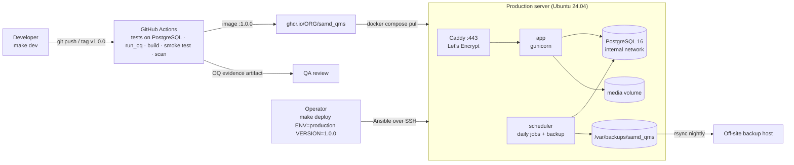

# SAMD_QMS deployment guide

SAMD_QMS ships as one container image that runs the same way in development and production.
Everything needed to build, run, provision, deploy and back it up is code in this repository.

| Environment | How it runs | Defined in |
| --- | --- | --- |
| Development (your laptop) | Docker Compose: app with live reload, PostgreSQL 16, Mailpit mail catcher | `compose.yaml`, `deploy/env/dev.env` |
| Staging and production (one Linux server each) | Docker Compose: Caddy (automatic HTTPS), app (gunicorn), scheduler, PostgreSQL 16 | `deploy/compose.prod.yaml`, `deploy/Caddyfile` |
| Server set-up and releases | Ansible over SSH | `deploy/ansible/` |
| Build, test, OQ evidence, image | GitHub Actions → GitHub Container Registry | `.github/workflows/ci.yml` |



## Development

Requirements: Docker with the Compose plugin, and `make`.

```bash
make dev            # build and start; app at http://localhost:8000, emails at http://localhost:8025
make demo           # load the two demo devices and users (password demo-pass-123)
make test           # run the test suite against the dev PostgreSQL
make shell          # Django shell
make manage CMD="createsuperuser"
make jobs           # also run the scheduler
make dev-reset      # wipe the dev database, files and backups
```

The source folder is mounted into the container, so code changes reload immediately. The
container migrates the database on start (`QMS_MIGRATE_ON_START=1`). Every email the app sends
appears in Mailpit. To try single sign-on locally, register a test app with the provider (ORCID
has a sandbox), add its `SSO_*` values to `deploy/env/dev.env`, and use
`http://localhost:8000/accounts/<provider>/login/callback/` as the redirect URL (Google and
Microsoft accept `localhost` over HTTP for testing).

Without Docker you can still run `pip install -r requirements.txt && python manage.py migrate
&& python manage.py runserver`; it falls back to SQLite.

## Releases and CI

1. Merge to `main`: CI runs the checks, the full suite on PostgreSQL 16, `run_oq` (evidence kept
   as a build artifact for 90 days), shellcheck, Compose and Ansible syntax checks, then builds the
   image, smoke-tests it as the unprivileged user, scans it with Trivy (report only) and pushes
   `:main` and `:sha-<commit>` for staging.
2. When ready to release, tag it: `git tag v1.0.0 && git push --tags`. CI pushes `:1.0.0`. This is
   the version you validate and deploy. Download the tag's OQ evidence artifact and file it as a
   controlled record.
3. Make the image private or public in GitHub's package settings. For a private image, give the
   server a read-only token (`vault_registry_user`, `vault_registry_token`).

## Production server

### What you need

- A server running Ubuntu 24.04 LTS (or 22.04, or Debian 12): 2 vCPU, 4 GB RAM and 40 GB disk
  is ample to start, in a UK data centre or as your data protection impact assessment requires.
- A DNS name pointing at it (e.g. `qms.example.org`), with ports 80 and 443 open to the
  internet so Caddy can obtain the TLS certificate.
- An SMTP relay account for notifications.
- An off-site backup location reachable over SSH (strongly recommended).
- On your machine: `ansible-core` (`pip install ansible-core`) and SSH access with sudo.

### First-time set-up

```bash
cd deploy/ansible
cp inventory.example.ini inventory.ini            # set your server names
$EDITOR group_vars/qms/vars.yml                   # domain, emails, image, SSO client ids, admin_ssh_keys
cp vault.example.yml group_vars/qms/vault.yml     # secrets
$EDITOR group_vars/qms/vault.yml
echo 'a long random passphrase' > ~/.samd_qms_vault_pass && chmod 600 ~/.samd_qms_vault_pass
ansible-vault encrypt group_vars/qms/vault.yml    # commit only the encrypted file
cd ../..
make provision ENV=staging
make deploy ENV=staging VERSION=1.0.0
```

`provision.yml` installs Docker from Docker's repository, configures log rotation, creates the
deploy user (SSH keys only) and directories, hardens SSH (no passwords, no root login), enables
the firewall (22, 80, 443 only), fail2ban, automatic security updates and time sync, and
schedules the nightly off-site `rsync` of backups when `backup_offsite_target` is set.

Then create the first administrator and set up roles and teams:

```bash
ssh qmsdeploy@qms.example.org
cd /opt/samd_qms && docker compose -f compose.prod.yaml exec app python manage.py createsuperuser
```

### Deploying a release

```bash
make deploy ENV=production VERSION=1.0.0
```

`deploy.yml` refuses placeholder or weak secrets and unpinned versions, writes `.env` and
`app.env` (mode 0600), pulls the image, takes a `pre-deploy` backup if the app is running, applies
migrations, starts all services and waits for them to be healthy, checks
`https://<domain>/healthz` reports the new version, verifies the audit chain, and appends a line
to `/opt/samd_qms/DEPLOYMENTS.log`. Deploy to staging first; production deployments need an
approved Change Request in SAMD_QMS.

### What runs on the server

| Service | Role | Notes |
| --- | --- | --- |
| `caddy` | HTTPS on 443, HTTP→HTTPS redirect, HSTS, security headers | Certificates renew automatically; `/media/` is never served |
| `app` | gunicorn, 3 workers × 2 threads | Read-only filesystem, no Linux capabilities, unprivileged user 10001; health check on `/healthz` |
| `scheduler` | Daily jobs (UTC): 02:30 backup, 03:00 audit verification, 05:30 PMS activities, 05:45 reminders | Each failure emails `QMS_ALERT_EMAILS` |
| `db` | PostgreSQL 16 | On an internal network with no internet route and no published port |

Data lives in Docker volumes `samd_qms_pgdata`, `samd_qms_media` and `samd_qms_caddy_data`, and
backups in `/var/backups/samd_qms`.

### Backups and restore

Every night `backup.sh` writes `/var/backups/samd_qms/<timestamp>-scheduled/` containing a
PostgreSQL dump, a tarball of uploaded files, and `manifest.json` with SHA-256 checksums and the
latest audit-trail hash. Backups older than `BACKUP_RETENTION_DAYS` (30) are pruned locally; the
off-site copy keeps whatever the destination's own policy keeps.

**Prove restores work** (validation IQ-08, then quarterly):

```bash
make restore-test ENV=production
```

This restores the newest backup into a throwaway PostgreSQL container on the server, checks the
checksums, verifies the audit chain and confirms the latest audit hash matches the manifest, then
removes everything it created.

**Disaster recovery** (production data lost or corrupted):

```bash
ssh qmsdeploy@qms.example.org && cd /opt/samd_qms
docker compose -f compose.prod.yaml stop app scheduler
docker compose -f compose.prod.yaml exec db dropdb -U qms qms
docker compose -f compose.prod.yaml exec db createdb -U qms qms
docker compose -f compose.prod.yaml run --rm --no-deps -e RESTORE_FORCE=1 \
  app /app/deploy/scripts/restore.sh /backups/<timestamp>-scheduled
docker compose -f compose.prod.yaml up -d
```

Record the recovery as an incident in SAMD_QMS, including the data-loss window (time of the
backup to time of failure).

### Rolling back a release

If the release did not change the database (`migrations=False` in `DEPLOYMENTS.log`), deploy the
previous version: `make deploy ENV=production VERSION=<previous>`. If it did, restore the
`pre-deploy` backup taken by that deployment (disaster-recovery steps above, using that folder),
then deploy the previous version.

### Monitoring

- Point an uptime monitor at `https://<domain>/healthz` (returns 200 with the version, 503 if the
  database or storage fails). It reveals no data.
- Alerts arrive by email when a scheduled job fails. Check them daily.
- Logs: `docker compose -f compose.prod.yaml logs -f app` (or `caddy`, `scheduler`, `db`).

## Settings reference

| Where | Setting |
| --- | --- |
| `group_vars/qms/vars.yml` | `qms_image`, `qms_version`, `qms_domain`, `acme_email`, SMTP, `alert_emails`, `qms_sso_allowed_domains`, SSO client ids, `admin_ssh_keys`, `backup_retention_days`, `backup_offsite_target`, `gunicorn_workers` |
| `group_vars/qms/vault.yml` (encrypted) | `vault_django_secret_key`, `vault_postgres_password`, `vault_smtp_password`, `vault_registry_*`, `vault_sso_*_secret` |
| `/opt/samd_qms/.env` (rendered) | Values substituted into `compose.prod.yaml` |
| `/opt/samd_qms/app.env` (rendered) | Application environment; see `deploy/env/app.env.example` |

## Validation mapping

| Validation step | Performed by |
| --- | --- |
| IQ-01 Environment and versions | `provision.yml`; image labels and `/healthz` version; `DEPLOYMENTS.log` |
| IQ-02 Settings, `check --deploy` | `deploy.yml` templates; CI "Production settings check" |
| IQ-03 HTTPS, cookies, session time-out | Caddy + Django security settings (active when `DJANGO_DEBUG=0`); verify in a browser |
| IQ-04 Email | Send a test with `docker compose ... exec app python manage.py send_alert "IQ-04 test"` |
| IQ-05 Single sign-on | SSO client ids/secrets in Ansible vars and vault |
| IQ-06 Audit trail | `deploy.yml` runs migrations and `verify_audit` |
| IQ-07 Scheduled jobs and alerts | `scheduler` service; test with `exec scheduler python manage.py run_scheduler --once verify_audit` |
| IQ-08 Backup and restore | `backup.sh` nightly; `make restore-test` |
| OQ | CI `run_oq` artifact for the release tag, or `make oq` |
