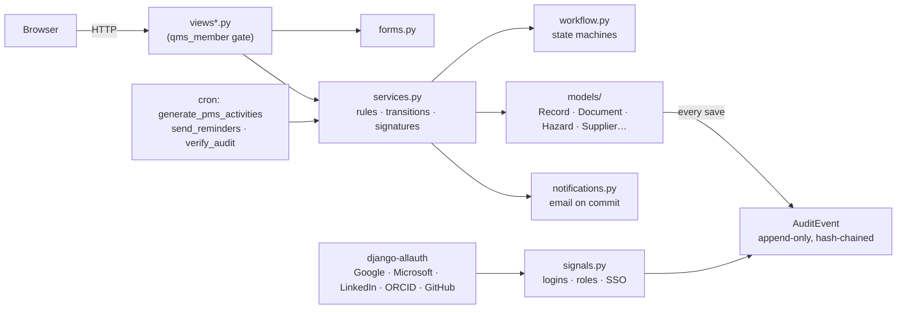
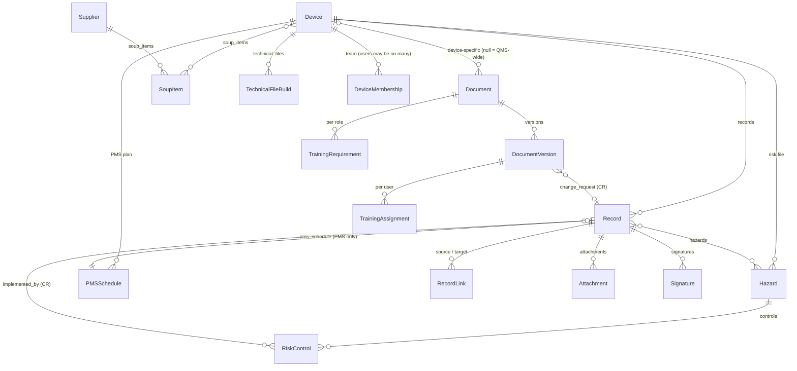

# SAMD_QMS developer guide

How SAMD_QMS is built, the rules the code enforces, and how to change it safely. For running and
configuring it, see [README.md](../README.md); for end users, see the in-app help at `/help/`
(source in `qms/help/`, described in [In-app help](#in-app-help)).

SAMD_QMS supports a regulated quality system. Treat every change as a change to a validated tool:
raise a Change Request, keep the test suite green, and re-run your validation for anything that
touches workflows, signatures, the audit trail or access control.

## Contents

1. [Architecture](#architecture)
2. [Code layout](#code-layout)
3. [Core invariants](#core-invariants)
4. [Data model](#data-model)
5. [Workflow engine](#workflow-engine)
6. [Services layer](#services-layer)
7. [Audit trail](#audit-trail)
8. [Electronic signatures](#electronic-signatures)
9. [Access control and single sign-on](#access-control-and-single-sign-on)
10. [Notifications](#notifications)
11. [Files](#files)
12. [Settings reference](#settings-reference)
13. [Management commands](#management-commands)
14. [Testing](#testing)
15. [Common changes](#common-changes)
16. [Devices and scoping](#devices-and-scoping)
17. [Technical file generation](#technical-file-generation)
18. [In-app help](#in-app-help)
19. [Deployment](#deployment)
20. [Validation](#validation)

## Architecture

A single Django 5.2 project (`config`) with one app (`qms`). Server-rendered templates, no
JavaScript framework, no API. django-allauth provides single sign-on.



Three layers, with a strict direction of responsibility:

| Layer | Responsibility | Must not |
| --- | --- | --- |
| Views and forms | HTTP, validation of input shape, messages | Change a status, create a signature, or encode a business rule |
| Services | Every business rule, status change and signature | Render templates |
| Models | Persistence, audit logging, immutability guards | Decide who may do what |

## Code layout

```
config/
  settings.py           Django settings plus every QMS_* setting (see Settings reference)
  urls.py               admin, login/logout, allauth (/accounts/), qms
qms/
  workflow.py           record types, statuses, transitions and their rules
  services.py           all business operations (transitions, documents, training, risk, suppliers)
  models/
    core.py             AuditEvent, AuditedModel, Record, RecordLink, Signature, SigningPin,
                        Attachment, PMSSchedule, helpers (add_months, sha256_of)
    devices.py          Device, TechnicalFileBuild, TECH_FILE_SECTIONS
    organisation.py     Organisation (the one profile), OPERATOR_ROLES (EU MDR economic operators)
    documents.py        Document, DocumentVersion, TrainingRequirement, TrainingAssignment
    risk.py             Hazard, RiskControl, risk_level()
    suppliers.py        Supplier, SoupItem
  views.py              dashboard, records, attachments, audit, signing PIN
  views_docs.py         documents and training
  views_risk.py         hazards, controls, suppliers, SOUP
  views_devices.py      devices, device switcher, teams and roles, technical file pages,
                        the organisation profile
  views_invitations.py  invite people, invitations list, the accept page (/invite/<token>/)
  roles.py              who holds which role on which device (every role check uses it)
  invitations.py        invitation rules: create, resend, revoke, accept
  techfile.py           technical file: gather, completeness checks, outline, HTML/DOCX, ZIP
  doc_route.py          the device page's documentation route: six stages of checks, read-only
  help.py               help topics, page → help section map, help text for every form field
  help/                 the help topics (Markdown), served at /help/
  views_help.py         help pages (open without sign-in; they hold no QMS data)
  templatetags/qms_help.py  help_icon / help_for: the ? icon and popover beside a field
  context_processors.py device switcher data and the page's help link, for every page
  validation.py         user requirements (URS) with risk and traced tests / manual protocols
  access.py             qms_member decorator, run() service wrapper, form_page()
  forms.py              all forms
  notifications.py      email events and the daily digest
  signals.py            security events and m2m audit logging
  sso.py                allauth adapters (sign-up and username rules)
  sso_settings.py       provider config from environment (imported by settings; no Django imports)
  current_user.py       request user in a ContextVar, for attribution in model code
  admin.py              admin registrations (evidence is read-only, nothing deletable)
  management/commands/  seed_qms, load_demo_data, generate_pms_activities, send_reminders,
                        verify_audit
  templates/            qms/*, registration/login.html, allauth/layouts/base.html and
                        socialaccount/connections.html (overrides), django/forms/p.html
                        (adds the help icon to every form)
  tests.py              record workflows, audit, PMS (18 tests)
  test_modules.py       documents, training, risk, suppliers, attachments, notifications,
                        security, SSO, connected accounts, pages (29 tests)
  test_devices.py       device scoping, completeness checks, technical file builds, software
                        items and their migration, choosing a device (29 tests)
  test_organisation.py  organisation profile and per-device economic operator roles (9 tests)
  test_teams.py         device-team isolation, multi-team members, All-device access (13 tests)
  test_ops.py           health check, scheduler and alerts (8 tests)
  test_help.py          every page and form field has help; help pages and icons (11 tests)
  test_roles.py         roles per device, Device admin, team pages, the 0004 migration (16 tests)
  test_invitations.py   inviting, the emailed link, expiry, resend, revoke, accepting (16 tests)
  test_doc_route.py     the documentation route's stages, gates and device-page panel (6 tests)
  management/commands/run_oq.py   operational qualification run and traced evidence
```

## Core invariants

These are the properties auditors rely on. Code reviews should reject any change that weakens them.

1. **Status changes only through services.** `Record.save()` raises `ImmutableError` if `status`
   changed without `_via_workflow=True`; `AuditedModel` subclasses do the same in
   `check_editable`. Only functions in `services.py` pass that flag.
2. **Nothing is deleted.** `delete()` raises on every QMS model; the admin removes delete
   permissions and the bulk-delete action. Records end in Closed, Rejected, Done, Obsolete or
   Retired instead.
3. **Terminal objects are locked.** Closed or Rejected records, obsolete documents, submitted
   document versions, completed training, accepted or retired hazards, and uploaded attachments
   refuse edits.
4. **Every change is attributed and logged.** Creation and every change to an audited field
   writes an `AuditEvent` with the actor, before and after values.
5. **The audit trail is append-only and tamper-evident.** See [Audit trail](#audit-trail).
6. **Approvals are signed and, where marked, independent.** See
   [Electronic signatures](#electronic-signatures).
7. **No role, no data.** Every page except login and the SSO flows requires a QMS role.
8. **No team, no device data.** Device-scoped objects are visible and actionable only to the
   device's team and to All-device access holders — checked in views (404), forms (choices and
   cross-device links) and services (`_device_error`).

## Data model



| Model | Reference | Notes |
| --- | --- | --- |
| `Device` | code, e.g. `HRT1` | Regulatory particulars (section 1 of the technical file) and its software items (`software_items`, one per line; `software_item_list()`). Changes audited. |
| `DeviceMembership` | `user @ CODE` | A person on a device's team; `active` toggled, never deleted. Unique per device and user. |
| `TechnicalFileBuild` | `TF-HRT1-001` | Generated package (ZIP), SHA-256, completeness results. Frozen; `generated → approved → superseded`. |
| `Record` | `PR-0001`, `CMP-`, `INC-`, `CAPA-`, `CR-`, `PMS-` | Belongs to one device (required). One table for all six types; `workflow.TYPE_FIELDS` decides which fields each type shows. Refs are allocated per type under `select_for_update`. |
| `RecordLink` | — | Typed, directional (`fixed_by`, `caused_by`, `escalated_to`, …). Unique per (source, target, type). Can't be removed from a locked record. |
| `Document` | `SOP-001`, `WI-`, `POL-`, `PLAN-`, `SPEC-`, `FORM-`, `RPT-` | Numbered per type. `obsolete` is set only by `obsolete_document`. |
| `DocumentVersion` | `SOP-001 v1.0` | `draft → in_review → approved → effective → superseded / obsolete`. File SHA-256 is stored on upload; content is frozen after submission. |
| `TrainingRequirement` | — | Document × role (`auth.Group`). Deactivated, never deleted. |
| `TrainingAssignment` | — | User × version, with due date and completion. Locked once completed. |
| `Hazard` | `HAZ-001` | Belongs to one device. Initial and residual severity/probability (1–5). `open → accepted / retired`. |
| `RiskControl` | `HAZ-001/RC-<id>` | Type, implementing CR, evidence, verified flag. Editable only while the hazard is open. |
| `Supplier`, `SoupItem` | — | Supplier status changes only by signed evaluation. |
| `Signature` | — | Points at a `Record`, or at any other object by `object_type` + `object_ref`. |
| `AuditEvent` | — | Same addressing as `Signature`. |
| `SigningPin` | — | Hashed with Django's password hasher. |

All QMS models except `Record`, `RecordLink`, `Signature`, `AuditEvent`, `SigningPin` and
`PMSSchedule` extend `AuditedModel`.

## Workflow engine

`qms/workflow.py` defines one state machine per record type:

```python
WORKFLOWS[PROBLEM_REPORT] = {
    "states": ["open", "triage", ..., "closed", "rejected"],
    "initial": "open",
    "transitions": [
        Transition("assess_risk", "Move to risk assessment", ("triage",), "risk_assessment",
                   required=("severity", "patient_safety_impact", "software_item",
                             "software_version")),
        Transition("verify", "Send to verification", ("in_fix",), "verification",
                   checks=(_has_link("fixed_by", CHANGE_REQUEST, "fixed by Change Request"),)),
        Transition("close", "Close", ("released",), "closed", roles=(QA,),
                   signature="Approval", independent=True),
        ...
    ],
}
```

`Transition` fields:

| Field | Effect |
| --- | --- |
| `sources` | Statuses the transition is available from |
| `target` | Resulting status |
| `roles` | Groups allowed to perform it (default: any QMS role) |
| `required` | Record fields that must be non-empty (`risk_file_updated="pending"` counts as empty) |
| `checks` | Callables `check(record) -> str or None`; a string blocks with that message |
| `signature` | If set, the meaning of the e-signature required (password or PIN re-entry) |
| `comment_required` | A comment must be given (rationales, rejections) |
| `independent` | Signer may not be the record's `created_by` (when `QMS_REQUIRE_INDEPENDENT_APPROVAL`) |

`TERMINAL_STATES = {"closed", "rejected", "done"}` lock a record. The UI is generated from these
definitions: `services.available_transitions()` returns each transition from the current status
with its blockers, and `record_detail.html` renders them.

Documents, hazards and suppliers don't use this engine. Their workflows are short enough to be
explicit functions in `services.py`.

## Services layer

All status changes and approvals live in `services.py`. Each function follows the same shape:

```python
def approve_version(version, user, secret, comment=""):
    errors = _role_error(user, [wf.QA])                 # 1. collect every blocker
    require(errors, version.status == "in_review", "...")
    _independent(errors, user, version.author)
    require(errors, version.verify(), "File integrity check failed ...")
    _check_secret(errors, user, secret)                 # 2. signature credential last
    if errors:
        raise TransitionError(errors)                   # 3. all reasons at once
    with transaction.atomic():                          # 4. sign, then change, atomically
        sign(version, user, secret, "Document approval", ...)
        _set_version_status(version, "approved", user, comment, approved_at=timezone.now())
    return version
```

Conventions:

- Collect **all** blockers and raise `TransitionError(list)`, so the UI can show every reason.
- Do role checks with `user_has_role` / `_role_error`. Superusers pass every role check and are
  exempt from the independence rule, but still have to sign. Keep superuser accounts to
  administrators who don't take part in approvals, or remove the exemption in `_independent`
  and `check_transition`.
- Sign **before** the change, inside the same transaction, so the signature's state hash covers
  the state that was approved.
- Pass the acting user to saves as `_actor=user` (and `_comment=` where relevant). Model code
  falls back to the request user, but explicit is required outside requests (commands, tests).
- Views call services through `access.run(request, func, ...)`, which turns `TransitionError`
  and `ImmutableError` into page messages.

| Area | Functions |
| --- | --- |
| Records | `check_transition`, `available_transitions`, `perform_transition`, `generate_pms_activities` |
| Documents | `create_version`, `submit_version`, `return_version`, `approve_version`, `make_effective`, `review_no_change`, `obsolete_document` |
| Training | `assign_training_for_version`, `sync_training`, `complete_training`, `training_matrix` |
| Risk | `hazard_acceptance_blockers`, `accept_hazard`, `reopen_hazard`, `retire_hazard`, `risk_matrix` |
| Suppliers | `evaluate_supplier` |
| Shared | `sign`, `user_has_role`, `TransitionError` |

## Audit trail

`AuditEvent` rows are the system of record for "who did what, when".

- **Append-only.** `save()` refuses an existing pk; `delete()`, `QuerySet.update()` and
  `QuerySet.delete()` raise `ImmutableError`. The admin is read-only.
- **Hash chain.** On insert, under `select_for_update` of the last row, the event stores
  `prev_hash` (the previous event's hash, or 64 zeros) and `hash = SHA-256(canonical JSON of
  record, object, actor, timestamp, action, changes, comment, prev_hash)`. `changes` is
  normalised through JSON first, so the hash is identical after a database round-trip.
- **Verification.** `verify_audit_chain()` walks the chain and returns the first event whose
  stored hash or link doesn't match. It runs on the dashboard, the Audit page and
  `manage.py verify_audit` (non-zero exit on failure).
- **What it proves.** Any edit or deletion of history, including direct SQL, breaks the chain.
  It cannot restore lost data, and someone with database write access could rebuild the whole
  chain; for stronger guarantees, periodically export the latest hash to a separate system
  (e.g. an email to QA or a write-once store).

### Writing to it

- `AuditedModel.save(_via_workflow=False, _actor=None, _comment="")` logs `create` with all
  non-empty audited fields, or `update` (`transition` if `status` changed) with a
  `{field: [before, after]}` diff. Foreign keys are recorded by `str()` of the related object,
  not by id.
- Declare audited fields in `AUDITED`. Use `<fk>_id` for foreign keys; they are logged under
  the field name without `_id`.
- `Record` has its own equivalent using `AUDITED_FIELDS`. Hazard links (`Record.hazards`) and
  role changes (`User.groups`) are logged by `m2m_changed` receivers in `signals.py`.
- For anything else, call `AuditEvent.log(action, obj=..., actor=..., changes=..., comment=...)`.
  `obj` needs `audit_type` and `audit_ref` attributes.
- Attribution: `actor` if given, else the request user from `current_user.CurrentUserMiddleware`,
  else "system".

## Electronic signatures

`services.sign(obj, user, secret, meaning, ...)` creates a `Signature` holding the signer, their
printed name, the meaning, the transition and statuses, an optional comment, a timestamp, and
`record_state_hash` (SHA-256 of the object's audited fields at signing). It also writes a
`sign` audit event. Signatures can't be changed or deleted.

Callers must verify the credential first with `verify_signing_credential(user, secret)`:

- If the user has a `SigningPin`, only the PIN is accepted.
- Otherwise the account password is checked (if usable).
- SSO-only users have an unusable password, so they must set a PIN. `views.signing_pin` allows
  that only within `QMS_PIN_REAUTH_MINUTES` of a login (the login time is stored in the session
  by the `user_logged_in` receiver). Users with a password must enter it to set a PIN.

Every signing path goes through `services._check_secret`, which first applies
`sso.signer_identity_errors(user)`. When `QMS_SIGNER_SSO_PROVIDERS` is set (production only, by
Ansible), the signer's account must have a `SocialAccount` with one of those providers and, when
`QMS_SIGNER_EMAIL_DOMAINS` is set, a verified allauth `EmailAddress` at one of those domains
(subdomains count). It applies to superusers too. Empty settings (development, staging, tests)
mean no restriction. URS-24, `qms/test_signer_identity.py`.

Signature meanings in use: *Approval*, *Reportability decision*, *Regulatory submission*,
*Review*, *Document approval*, *Periodic review: no change needed*, *Document withdrawal*,
*Read and understood*, *Risk acceptance*, *Hazard retirement*, *Supplier evaluation*.

## Access control and single sign-on

### Roles

Four roles (constants in `workflow.py`): the working roles `Engineer`, `QA` and
`Clinical Safety Officer` (`wf.ANY_ROLE`), and `Device admin`, which invites people and manages a
device's team but has no approval powers (`wf.ROLES` is all four; `wf.TEAM_MANAGERS` is Device
admin and QA). Roles are held **per device**; see [Roles per device](#roles-per-device).

Pages are gated by `access.qms_member` (login **and** a working role on some device or
organisation-wide; superusers always pass) or, for device and team pages, `access.team_member`
(any role, so a Device admin with no working role can still manage their teams). A signed-in user
without a role gets `access_pending.html` with HTTP 403.

The admin site is for staff users only. `seed_qms` gives the QA group all `qms` model permissions;
make QA leads `is_staff` so they can manage users and roles. On production it answers only
through the SSH tunnel: Caddy returns 404 for `/admin/` on the public site, and
`qms.admin_access.AdminHostMiddleware` does the same for any host not in `QMS_ADMIN_HOSTS`
(production: `localhost:8443`), which also hides the header's Admin link (finding F7;
[deployment guide](deployment.md#administration-admin-through-an-ssh-tunnel)).

### Single sign-on

django-allauth handles the OAuth/OIDC flows. Configuration is environment-driven:
`sso_settings.configured_providers()` builds `SOCIALACCOUNT_PROVIDERS` from `SSO_<PROVIDER>_CLIENT_ID`
and `SSO_<PROVIDER>_SECRET` and enables only the providers that have both.

| Provider | allauth provider | Login URL | Notes |
| --- | --- | --- | --- |
| Google | `google` | `/accounts/google/login/` | `prompt=select_account` |
| Microsoft | `microsoft` | `/accounts/microsoft/login/` | `SSO_MICROSOFT_TENANT` (default `organizations`) |
| GitHub | `github` | `/accounts/github/login/` | scopes `read:user user:email` |
| ORCID | `orcid` | `/accounts/orcid/login/` | public API; `SSO_ORCID_DOMAIN` for sandbox; no email |
| LinkedIn | `openid_connect`, id `linkedin` | `/accounts/oidc/linkedin/login/` | OIDC discovery at `https://www.linkedin.com/oauth` |

Callback URLs are the login URL plus `callback/`.

Account rules (`sso.py` and settings):

- `AccountAdapter.is_open_for_signup` is always `False`: no local self-registration.
- `SOCIALACCOUNT_EMAIL_AUTHENTICATION` + `..._AUTO_CONNECT`: an SSO login attaches to an existing
  user whose email the provider reports as **verified**.
- `SocialAccountAdapter.is_open_for_signup` allows a new account only for a verified email in
  `QMS_SSO_ALLOWED_DOMAINS` (exact domain or subdomain).
- `SOCIALACCOUNT_LOGIN_ON_GET = False`: logins start with a CSRF-protected POST.
  `SOCIALACCOUNT_STORE_TOKENS = False`.
- New SSO users trigger `notifications.user_awaiting_access`.
- `signals.py` logs login (with method `password` or `sso:<provider>`), logout, failed login,
  account created via SSO, and SSO accounts connected or disconnected.

`templates/allauth/layouts/base.html` wraps allauth's pages (connected accounts, errors) in the
QMS layout. The `qms` app is listed before `allauth` in `INSTALLED_APPS` so this override wins.

## Notifications

`notifications.send(subject, body, users)` emails active users with an address. Delivery runs in
`transaction.on_commit`, so a rolled-back change sends nothing, and failures are logged rather
than raised. Disable all email with `QMS_NOTIFICATIONS_ENABLED = False`.

| Event | Function | Called from |
| --- | --- | --- |
| Incident or complaint created | `record_created` | `Record.save` |
| Owner changed | `record_assigned` | `Record.save` |
| Record moved to a status whose next step needs a specific role | `record_transitioned` | `perform_transition` |
| Version submitted | `document_submitted` | `submit_version` |
| Version effective | `document_effective` | `make_effective` |
| Training assigned | `training_assigned` | `assign_training_for_version` |
| SSO user awaiting a role | `user_awaiting_access` | `signals.on_signed_up` |
| Daily digest | `daily_reminders` | `send_reminders` command |

In tests, wrap actions in `self.captureOnCommitCallbacks(execute=True)` to deliver to
`mail.outbox`.

## Files

Attachments and document files are stored under `MEDIA_ROOT` (`attachments/YYYY/MM/` and
`documents/<number>/v<version>/`). They are **not** served from `MEDIA_URL`: downloads go through
login-protected views (`attachment_download`, `version_download`) that recompute SHA-256 and
refuse a file that doesn't match. Upload validation (`forms.validate_upload`) enforces
`QMS_ATTACHMENT_EXTENSIONS` and `QMS_ATTACHMENT_MAX_MB`. Never configure your web server to serve
the media directory publicly.

## Settings reference

| Setting | Default | Purpose |
| --- | --- | --- |
| `QMS_VIGILANCE_DEADLINES` | 2 / 10 / 15 days | Incident deadline categories and days from date aware. Verify against MHRA guidance. |
| `QMS_REQUIRE_INDEPENDENT_APPROVAL` | `True` | Enforce `independent` transitions and author ≠ approver for documents |
| `QMS_PMS_HORIZON_DAYS` | `30` | How far ahead PMS activities are created |
| `QMS_TRAINING_DUE_DAYS` | `14` | Training due date after assignment |
| `QMS_INVITATION_DAYS` | `14` | Default expiry of an invitation link |
| `QMS_INVITATION_MAX_DAYS` | `30` | Longest expiry an inviter can choose |
| `QMS_SOUP_REVIEW_DAYS` | `35` | SOUP anomaly review is overdue after this |
| `QMS_RISK_ACCEPTABLE_MAX` | `4` | Score ≤ this is acceptable |
| `QMS_RISK_UNACCEPTABLE_MIN` | `10` | Score ≥ this is unacceptable |
| `QMS_ATTACHMENT_MAX_MB` | `25` | Upload size limit |
| `QMS_ADMIN_HOSTS` | empty | Hosts where Django admin answers (production: `localhost:8443`, the SSH tunnel); empty = all |
| `QMS_SIGNER_SSO_PROVIDERS` | empty | Production: signers must be connected to one of these providers (env, comma-separated) |
| `QMS_SIGNER_EMAIL_DOMAINS` | empty | Production: and have a verified email at one of these domains |
| `QMS_ATTACHMENT_EXTENSIONS` | pdf, docx, xlsx, csv, txt, md, png, jpg, jpeg, json, zip, log, html | Upload allowlist |
| `QMS_NOTIFICATIONS_ENABLED` | `True` | Master switch for email |
| `QMS_REMINDER_LOOKAHEAD_DAYS` | `7` | "Due soon" window in the daily digest |
| `QMS_BASE_URL` | env, `http://127.0.0.1:8000` | Absolute links in emails |
| `QMS_SSO_ALLOWED_DOMAINS` | env, empty | Domains allowed to self-create via SSO |
| `QMS_PIN_REAUTH_MINUTES` | `15` | Window after login for SSO users to set a PIN |

Environment variables: `DJANGO_SECRET_KEY`, `DJANGO_DEBUG`, `DJANGO_ALLOWED_HOSTS`,
`DJANGO_MEDIA_ROOT`, `DJANGO_EMAIL_HOST`, `DJANGO_EMAIL_PORT`, `DJANGO_EMAIL_USER`,
`DJANGO_EMAIL_PASSWORD`, `DJANGO_EMAIL_TLS`, `DJANGO_FROM_EMAIL`, `QMS_BASE_URL`,
`QMS_SSO_ALLOWED_DOMAINS`, and `SSO_*` (see [Single sign-on](#single-sign-on)).

## Management commands

| Command | When | What |
| --- | --- | --- |
| `seed_qms [--demo]` | Install | Creates roles and gives any device lacking it the standard PMS schedule; `--demo` adds demo users |
| `load_demo_data` | Trials only | `seed_qms --demo` plus two example devices with documents, hazards, suppliers and records |
| `generate_pms_activities [--horizon-days N]` | Daily | Creates PMS Activity records due within the horizon; idempotent |
| `send_reminders` | Daily | `sync_training()` then the daily email digest |
| `verify_audit` | Daily | Verifies the hash chain; exits non-zero on failure |

## Testing

```bash
python manage.py test qms                 # 172 tests, ~2 min on SQLite
python manage.py run_oq --executed-by "Name" --release 1.0.0 --output oq_evidence/
python manage.py test qms.test_modules.SSOTests
python manage.py test qms.test_ui         # browser interface tests only (or: scripts/local.sh ui)
make coverage                             # coverage report and htmlcov/ (pip install -r requirements-dev.txt)
```

**Interface tests.** `qms/test_ui.py` drives the app in headless Chromium with
[Playwright](https://playwright.dev/python/) against Django's live test server
(`StaticLiveServerTestCase`): signing in from the landing page, every main page, the help link and
field-help popovers, choosing a device after sign-in and switching to another, the device
switcher, raising a Problem Report and signing its rejection (a
wrong password first), the account-request captcha solved by the page's own JavaScript, and the
SSO-only invitation page. Every test also fails on any JavaScript error or console error. They are
traced to URS-83.

- Set up once: `pip install -r requirements-dev.txt && python -m playwright install chromium`
  (`scripts/local.sh setup` does both). CI installs Chromium before the OQ.
- Without Playwright the tests are skipped with that hint, and `run_oq` then fails URS-83: OQ
  evidence must include them. The Docker dev image has no browser, so `make test` skips them;
  `make oq` and `make ui` run on your machine instead.
- Watch them: `QMS_UI_HEADED=1 QMS_UI_SLOWMO=300 python manage.py test qms.test_ui`, or
  `make ui HEADED=1`.
- Write new ones with `BrowserTestCase`: `self.sign_in(username)`, `self.field(label, scope)`
  (the control with that label, not its help icon), Playwright's `expect(...)` for anything that
  appears after a request, and `self.assertNoBrowserErrors()` at the end. The live server
  commits for real, so `on_commit` emails are sent at once (no `captureOnCommitCallbacks`).
  Prefer roles and labels to CSS selectors so the tests also check what people see.

**Coverage.** `.coveragerc` measures `qms` and `config` with branch coverage, leaving out
migrations and the tests themselves. CI runs the OQ under `coverage`, puts the report in the run's
summary, keeps the HTML report as an artifact, and fails if total coverage drops below 75%
(81% at the time of writing).

**Badges.** On each push to `main`, CI writes `tests.svg`, `coverage.svg` and `oq.svg` with
`.github/scripts/badges.py` (no third-party service) and force-pushes them to the orphan `badges`
branch, which the README links to. The "Publish badges" job is the only one with write access, and
runs even when tests fail so the badges show it.

What's covered: every record workflow rule (required fields, roles, links, comments, independence,
signatures), locking and no-delete, audit attribution, immutability and tamper detection,
document lifecycle including file tampering, training assignment and sign-off, risk acceptance
rules, supplier evaluation, attachment validation and checksums, notifications, security events,
the role gate, SSO buttons, redirects to Google, Microsoft, GitHub and ORCID, sign-up rules and
provider configuration, rendering of every page, and the main journeys in a real browser.

Not covered automatically: complete SSO round-trips with real providers (LinkedIn's redirect
needs network access for OIDC discovery). Test those manually per provider when you configure
credentials, and record the result as part of validation.

When adding features, add tests for the rule (what's blocked and why) as well as the happy path.
Tests that upload files use `@override_settings(MEDIA_ROOT=<tempdir>)`.

## Common changes

### Add a field to a record type

1. Add the field to `Record` in `models/core.py`.
2. Add it to `AUDITED_FIELDS` so changes are logged.
3. Add it to the relevant lists in `workflow.TYPE_FIELDS` (forms and detail pages follow).
4. If a step needs it, add it to that transition's `required`.
5. Add its help to the `record` group in `qms.help.FIELD_HELP`. `test_help` fails until you do.
6. `python manage.py makemigrations qms`, add a test, run the suite.

### Add or change a transition

Edit the `transitions` list in `WORKFLOWS`. Add any status to `states`. If the new status is
terminal, add it to `TERMINAL_STATES`. Add a test for both the blocked and the allowed path.

### Add a record type

1. Add the constant, an entry in `RECORD_TYPES`, a `REF_PREFIX`, a `TYPE_FIELDS` entry and a
   `WORKFLOWS` entry in `workflow.py`.
2. Add any new fields to `Record` and `AUDITED_FIELDS`.
3. If it needs special deadlines, extend `Record.next_deadline`.
4. Migrate and test. The dashboard, lists, create form and detail page pick it up automatically.

### Add a new module

1. Model in `models/<module>.py` extending `AuditedModel`, with `AUDITED` and `check_editable`
   for anything that locks; export it from `models/__init__.py`.
2. Rules and status changes as functions in `services.py`, using `require`, `_role_error`,
   `_check_secret`, `sign` and `_actor`.
3. Views in a `views_<module>.py` decorated with `@qms_member`, calling services through `run()`.
4. Templates extending `qms/base.html`, reusing `_audit.html` and `_signatures.html`. A detail
   page with a side column uses `<div class="grid split">` (main column 2fr, side column at least
   280px, stacked into one column below 860px), not an inline `grid-template-columns`.
5. URLs, admin (`NoDeleteAdmin` or `ReadOnlyAdmin`), navigation link, dashboard widget if useful,
   reminder lines in `daily_reminders`, and tests.
6. Help: a topic in `qms/help/` (and `help.TOPICS`), each new URL name in `help.PAGE_HELP`, and
   a `FIELD_HELP` group for each form. `test_help` lists anything missing.

### Add an SSO provider

Add the allauth provider app to `INSTALLED_APPS`, add a block to
`sso_settings.configured_providers()` reading `SSO_<NAME>_CLIENT_ID` / `_SECRET`, document the
callback URL, and extend `SSOTests`. For providers that don't return verified emails, users must
connect them from Connected accounts.

## Devices and scoping

A `Device` is the unit a technical file is built for. What belongs to a device:

| Belongs to one device | Shared across devices |
| --- | --- |
| Records (`Record.device`, required), hazards and risk controls, PMS schedules and activities, technical file builds | QMS-wide documents (`Document.device` null), training, suppliers, users and roles |
| Device-specific documents (`Document.device` set) | SOUP items can be linked to several devices (`SoupItem.devices`) |

**Choosing a device.** `LOGIN_REDIRECT_URL` is `qms:device_list`, so after sign-in (password or
SSO, unless a `next` link says otherwise) people see **Your devices**: each device they can see,
their roles on it (`roles.device_roles`, organisation-wide ones flagged), and an **Open** button,
shown only for a working role, that posts to `set_device` with `next` set to the dashboard.
**Devices** in the top bar returns to that page to switch.

**Switcher.** `views_devices.set_device` stores the chosen device id in the session
(`access.SESSION_DEVICE_KEY`); `access.current_device(request)` reads it and
`access.scope(queryset, request, field)` filters by it. Lists, the dashboard and the risk matrix are
scoped; create forms default to the current device. Document lists show the device's documents
plus QMS-wide ones. The `qms.context_processors.devices` processor supplies the switcher.

**Economic operator roles.** `models/organisation.py` holds the EU MDR roles: manufacturer,
authorised representative, importer and distributor (Art. 2(30)-(34)). There is one
`Organisation` row (`Organisation.current()`, None until someone fills it in), edited at
`/organisation/` by QA held organisation-wide only (`views_devices._can_edit_organisation`), and
audited. Its `roles` list every role the organisation holds; `Device.operator_roles` records which
apply to that device. Both are comma-separated codes, edited through `forms.OperatorRolesField`.
`DeviceForm` offers only the profile's roles (all four while the profile lists none) and fills an
empty manufacturer or UK Responsible Person / authorised rep. field with the organisation's name
and address when that role is chosen. `OrganisationForm` refuses to drop a role an active device
still uses. Technical file section 1 shows the organisation, its SRN and its role for the device;
`completeness_checks` warns while a device has no role. The roles are recorded only: they don't
change workflows or which checks apply. Traced to URS-74.

**New devices.** Creating a device (QA only) calls `services.setup_device_pms`, which copies
`DEFAULT_PMS_SCHEDULES`. Edit those defaults, or the device's schedules in the admin.

**Software items.** Each device lists its own software items (`Device.software_items`, one per
line), from its IEC 62304 architecture. `Record`, `Hazard` and `SoupItem` store the item's name in
`software_item` (plain text). `forms.DeviceScopedForm` swaps in `SoftwareItemInput`, a text box with
a datalist of the user's devices' items, and its `clean()` requires the value to be one of the
chosen device's items (any of the selected devices, for SOUP), normalising the spelling. A device
with no list accepts any name; the technical file check warns that the list is missing. Migration
`0003` turned the old fixed codes (`asr`, `web_app`, …) into their labels and filled each device's
list from the items its data already used.

### Device teams

Roles say what someone may do (Engineer, QA, Clinical Safety Officer); device teams say which
devices they may do it on. A person can be on any number of teams.

- `DeviceMembership(device, user, active, note)` — audited, deactivated rather than deleted.
- The `All-device access` group (`wf.ALL_DEVICES`) sees every device: for heads of quality and
  auditors. Superusers also see everything. It is not a working role: holders still need one of
  the three roles.
- `access.accessible_devices(user)`, `access.can_access(user, device)` (None = QMS-wide, always
  allowed), `access.require_access(request, device)` raises 404 so other teams' references aren't
  revealed. `access.scope(qs, request, field, allow_shared=False)` limits any queryset to
  accessible devices and the current device; `allow_shared` keeps rows with no device.
- **Views:** every object lookup is followed by `require_access`; lists use `scope`.
- **Forms:** `forms.DeviceScopedForm` narrows every Device, Hazard and Record choice to accessible
  devices. `RecordFormBase.clean` refuses hazards from another device even for people on both
  teams; `LinkForm` refuses links to records you can't see; risk controls can only be implemented
  by Change Requests of the hazard's device.
- **Services:** `_device_error(user, device)` is added to every rule check (transitions, document
  workflow, hazards, technical files), so direct calls can't bypass the UI.
- **Training:** required roles are matched on the document's device (anywhere for QMS-wide
  documents) through `roles.users_with_roles`. **Notifications:** `notifications.users_in_roles(
  roles, device)` uses the same function, so emails go only to people holding the role on that
  device.
- **Audit:** the full audit trail page and CSV export require All-device access; each object's
  own trail follows its access.
- **Managing teams:** Device admins and QA on the device (`roles.can_manage_team`) add existing
  users with roles (`team_add`), change roles (`team_roles`) and remove members (`team_remove`) on
  the device page, and invite new people. Nobody changes their own roles. The creator of a device
  joins its team as QA and Device admin. A device always keeps a member, and one who can manage
  it (`views_devices._managers_left`, which counts organisation-wide roles too). Changes run
  `sync_training()`.

### Roles per device

`DeviceMembership.roles` holds a person's roles on that device as text (`"Engineer, QA"`);
`role_list()` reads it and `set_roles()` validates and orders it, as does `clean()` for Admin.
Everything else goes through `qms/roles.py`:

| Function | Meaning |
| --- | --- |
| `org_roles(user)` | Organisation-wide roles: the `auth.Group`s of the same names, set in Admin |
| `device_roles(user, device)` | Roles on a device: its membership roles plus organisation-wide roles, but only if the person can see the device. `None` means QMS-wide: roles held anywhere |
| `has_role(user, roles, device=None)` | The one check every rule uses (`services.user_has_role` and `_role_error` delegate to it) |
| `users_with_roles(roles, device=None)` | Recipients for emails and training |
| `can_manage_team(user, device)`, `managed_devices(user)` | Device admin or QA there |

Every service check passes the item's device: records (`record.device`), document versions
(`document.device`, `None` for QMS-wide), hazards, technical file builds. QMS-wide actions
(supplier evaluation, QMS-wide documents, creating a device) accept the role on any device.

Migration `0004` copied each person's groups onto each of their active memberships, removed the
working groups from people on a team who lack All-device access (so nobody gained or lost a
permission, and roles are now per device), kept organisation-wide roles for All-device holders,
and made each device's QA members (or else its first member) its Device admin.

### Account requests and the landing page

`/` shows `landing.html` to visitors and the dashboard to people signed in. `/request-access/`
is open: the browser solves a captcha (`qms/captcha.py`: an ALTCHA-format proof of work signed
with `SECRET_KEY`, bound to the session, single use and expiring; or Cloudflare Turnstile), which
marks the session for `QMS_ACCESS_REQUEST_MINUTES`. Only then does `SocialAccountAdapter`
allow single sign-on to create an account, and only with a provider in
`QMS_ACCESS_REQUEST_PROVIDERS`. The new account has no role. `qms/access_requests.py` holds the
rest: the `AccessRequest` (audited, immutable once decided), email confirmation by signed link
when the provider gave no verified address (ORCID), approval onto a team the reviewer manages
(`can_manage_team`), and decline by QA with a reason. `SOCIALACCOUNT_EMAIL_REQUIRED` is off so
ORCID can register; every other route to a new account still checks a verified email.

### Invitations

`qms/invitations.py` holds the rules; `views_invitations.py` the pages; `models/invitations.py`
the `Invitation` (audited, `INV-0001`; immutable once accepted or revoked).

- `create_invitation(inviter, email, {device: roles}, days, message)`: the inviter must manage each
  device's team; one pending invitation per address and device; expiry 1 to
  `QMS_INVITATION_MAX_DAYS` days (default `QMS_INVITATION_DAYS`). The token is
  `secrets.token_urlsafe(32)`; only its SHA-256 (`token_hash`) is stored. The email
  (`notifications.invitation`) carries `https://HOST/invite/<token>/`.
- `invitation_accept` (`/invite/<token>/`) needs no login: the link is the credential. Signed in,
  the account must have the invited address (`user.email` or a verified allauth `EmailAddress`).
  Signed out, a person without an account registers **only with single sign-on** (no local
  username or password): opening the link stores the token in the session, and
  `sso.SocialAccountAdapter.is_open_for_signup` allows a new account for that provider-verified
  address. `invitations.signup_providers` lists the configured providers that verify email (all
  but ORCID). With none configured the page says so and offers no way to register; an
  administrator can still create an account in `/admin/` and the person signs in to accept.
- `accept()` re-checks every grant (`valid_grants`: device active, inviter still manages it),
  adds roles to existing memberships (never removes any), marks the invitation accepted under
  `select_for_update` so it can't be used twice, and runs `sync_training()`.
- `resend()` issues a new token and expiry (the old link stops working); `revoke()` closes it.
  Either is allowed for the inviter or anyone who manages every device in it.

**Documentation route.** `qms/doc_route.py` works out the six-stage panel at the top of the
device page (set-up; intended purpose and classification; requirements and design; risk; verification
and evidence; release and post-market). `stages(device, data, checks)` takes `techfile.gather`
and `techfile.completeness_checks`, so the page computes them once. It stores nothing and changes
nothing: each check reads existing fields, documents by `tech_file_section`, hazards and controls,
SOUP, records and builds. Gate checks are flagged `gate=True`. To add a check, add an `_item` to
its stage with the URL name where it is fixed, then update the help topic (`devices.md`, "Follow
the documentation route"), the `route` group in `FIELD_HELP` if the panel's meaning changes, and
`test_doc_route`. The panel heading and each gate line carry `` icons.
Traced to URS-103.

## Technical file generation

`qms/techfile.py` builds a device's technical documentation from live data. The pipeline:

1. **`gather(device)`** collects: effective versions of documents tagged with each
   `tech_file_section` (device-specific and QMS-wide), QMS procedures, active hazards with
   controls, linked SOUP, closed Change Requests grouped by `fix_version` (release history),
   open Problem Reports (known residual anomalies, IEC 62304 §5.8.3), complaints, incidents,
   CAPAs, PMS activities and overdue items.
2. **`completeness_checks(device, data)`** returns `{level, section, message}` items. *Errors*
   block approval: missing intended purpose, description or manufacturer; no class for any market,
   or a market whose class is not yet determined (`Device.eu_classification`,
   `uk_classification`, `us_classification`, with choices from `EU_CLASSES`, `UK_CLASSES` and
   `US_CLASSES` in `models/devices.py`; "" means not placed on that market); no software safety class; no hazards; an unaccepted hazard whose risk is
   unacceptable; a tagged document failing its integrity check; no Declaration of Conformity
   for an on-market device; a broken audit chain. Everything else is a *warning* (missing
   section documents, unaccepted or unverified risks, stale SOUP reviews, open safety problems,
   open incidents, overdue items, missing UDI-DI or standards).
3. **`build_outline(...)`** turns the data into blocks — `title`, `h1`, `h2`, `p`, `note`, `kv`,
   `table`. Sections: 1 Device description, 2 Information supplied by the manufacturer,
   3 Design and manufacturing (design docs, QMS procedures, SOUP, release history, residual
   anomalies), 4 GSPR (standards, checklist), 5 Benefit-risk and risk management (summary,
   hazards, controls, rationales, acceptance signatures), 6 Verification and validation,
   7 Post-market surveillance, 8 Declaration of conformity, Annex A completeness check,
   Annex B previous builds.
4. **`to_html(blocks)`** and **`to_docx(blocks)`** render the same blocks, so the Word and HTML
   files always agree. HTML is self-contained with print CSS; Word is landscape with grid
   tables (python-docx).
5. **`generate_technical_file(device, user)`** writes a ZIP:

```
TF-HRT1-001/
  00_technical_file.docx, 00_technical_file.html
  manifest.json               device, generator, time, SHA-256 of every file, check results
  registers/                  risk_register, risk_controls, soup_list, quality_records,
                              audit_trail (device-scoped) as CSV
  documents/<section>/        each effective tagged document file, checksum-verified
```

   It stores a `TechnicalFileBuild` with the package's SHA-256 and the check counts. Labels are
   allocated per device under `select_for_update`.
6. **`approve_technical_file(build, user, secret, comment)`** requires QA, no errors, a comment
   if there are warnings, a signer other than the generator, an intact package, and a signature
   (*Technical file approval*). The device's previous approved build becomes *superseded*.

To add content to the technical file: add data to `gather`, a check to `completeness_checks`
if it can be missing, and blocks to `build_outline`; both outputs pick it up. To add a section
for documents, add it to `TECH_FILE_SECTIONS` (and `SECTION_NUMBERS`, and `EXPECTED_SECTIONS`
if it's mandatory), then make a migration.

The generated file is a compilation of QMS evidence, not a substitute for the documents a
notified or approved body expects; the completeness check only verifies that the expected pieces
exist, not that they are adequate.

## In-app help

Users get help in two places, both from `qms/help.py`:

- **Help** in the header of every page opens the help section for that page in a new tab.
  `context_processors.page_help` looks up the URL name in `PAGE_HELP` (topic and heading anchor);
  allauth pages fall back to the sign-in sections.
- **The ? icon beside each form field** opens a popover with the field's help and a link to the
  field reference. Forms rendered with `as_p` get it automatically through the override of
  `django/forms/p.html` (enabled by `FORM_RENDERER = TemplatesSetting` and `django.forms` after
  `qms` in `INSTALLED_APPS`). Fields laid out by hand use ``; plain HTML
  inputs use ``.

`FIELD_HELP` groups fields by form: a model form uses its model name (`record`, `hazard`, …), other
forms are mapped in `FORM_GROUPS`. Each group names its help topic; the topic page ends with a
generated **Fields** reference listing every field in its groups, with anchors such as
`#field-record-severity`, so the icon text and the guide never disagree. Help text can use
`{placeholders}` filled from settings in `help_vars()` (deadlines, file types, risk thresholds).

Topic pages are Markdown in `qms/help/<slug>.md`, rendered with Python-Markdown (tables, toc,
md_in_html) and cached per process. They describe behaviour only: keep device names out
(`test_help` checks). The popover uses the HTML `popover` attribute, so it needs no JavaScript,
closes with Esc, and is positioned beside its icon where CSS anchor positioning is supported.

`test_help` fails when a URL name has no `PAGE_HELP` entry, an anchor doesn't exist, a form field
or plain input has no help, or a `help_for` names an unknown field. Requirement URS-81 traces it.

## Deployment

Infrastructure is code; the full procedure is in [deployment.md](deployment.md).

| File | Purpose |
| --- | --- |
| `Dockerfile` | Two-stage build on `python:3.13-slim`; static files collected at build; runs as uid 10001; `HEALTHCHECK` on `/healthz` |
| `deploy/scripts/entrypoint.sh` | Waits for PostgreSQL; migrates and seeds only when `QMS_MIGRATE_ON_START=1` (development) |
| `compose.yaml` | Development: app (live reload), PostgreSQL, Mailpit; optional scheduler profile |
| `deploy/compose.prod.yaml` | Production: Caddy, app, scheduler, PostgreSQL on an internal network; read-only, capability-free app containers |
| `deploy/Caddyfile` | Automatic HTTPS, security headers, blocks `/media/` |
| `deploy/gunicorn.conf.py` | Workers, threads, timeouts (180 s for technical files) |
| `deploy/scripts/backup.sh`, `restore.sh` | Checksummed backups with the latest audit hash; restore with verification and empty-target guard |
| `deploy/ansible/` | `provision.yml` (server), `deploy.yml` (release), `restore-test.yml` (IQ-08) |
| `.github/workflows/ci.yml` | Tests on PostgreSQL, `run_oq` artifact, infra lint, image build, smoke test, scan, push to GHCR |
| `Makefile` | `make help` lists every shortcut |

App-side support:

- `DATABASE_URL` (dj-database-url), SQLite fallback for quick local runs.
- WhiteNoise serves fingerprinted static files; media is only served through login-protected views.
- `GET /healthz` (`qms/health.py`): unauthenticated; 200/503 with the release label only; exempt
  from the HTTPS redirect so the proxy and container can probe it.
- `manage.py run_scheduler` runs `QMS_SCHEDULED_JOBS` (UTC) as subprocesses and calls
  `send_alert` on failure; `--once <job>` runs one now.
- With `DJANGO_DEBUG=0`: HTTPS redirect, HSTS, secure cookies, `X-Frame-Options: DENY`, and
  `SECURE_PROXY_SSL_HEADER` for the Caddy proxy.
- Logs go to stdout (`docker compose logs`).

## Validation

The approved SAMD_QMS Validation Plan governs validation (IQ, OQ, PQ, release, change control).
The code supports it in two ways:

- **`qms/validation.py`** lists the user requirements (59 requirements, numbered URS-01 … URS-108
  in groups, so the IDs are not contiguous) with their risk, the automated tests that verify each
  one, and the manual IQ/PQ protocols. Every test must be traced to a requirement. To add one,
  take the next unused ID, not the next integer.
- **Release identification:** `QMS_VERSION` and `QMS_COMMIT` (build args, set by CI from the tag
  and `github.sha`; outside a container the commit comes from `git rev-parse HEAD`) are shown at
  the top of every page, in admin and on `/healthz`, so a screenshot or audit observation always
  names the exact build. `QMS_COPYRIGHT` in `config/settings.py` is shown at the foot of every
  page and on the OQ report. Covered by URS-82.
- **`manage.py run_oq`** runs the suite in a test database and writes `oq_report.html` (with
  environment, versions, commit, per-requirement results and sign-off boxes), `oq_results.csv` and
  `oq_results.json`. It exits non-zero if any test fails, a traced test is missing, a requirement
  fails, or a test is untraced.

When you add or change behaviour: add or update the requirement, add tests, trace them, and run
`run_oq`. A change to `validation.py` is a change to the validated state and goes through change
control.

In summary:

1. **Intended use and risk:** document what the tool is used for and what could go wrong (lost
   records, a wrong status, an unattributed change), and which controls address each.
2. **Requirements:** use the [core invariants](#core-invariants) and the workflow rules as the
   requirement set.
3. **Verification:** `run_oq` output is the objective evidence for automated requirements; keep it
   for each release. Add manual tests for SSO per provider, email delivery,
   backup and restore, and the deployed configuration.
4. **Release control:** every change to SAMD_QMS goes through a Change Request in SAMD_QMS
   itself, with the test run linked as verification evidence and the version recorded in
   `fix_version`.
5. **Periodic review:** re-validate on Django or allauth major upgrades and after any change to
   `workflow.py`, `services.py`, `techfile.py`, `models/core.py`, `access.py`, `sso*.py` or
   `signals.py`.
